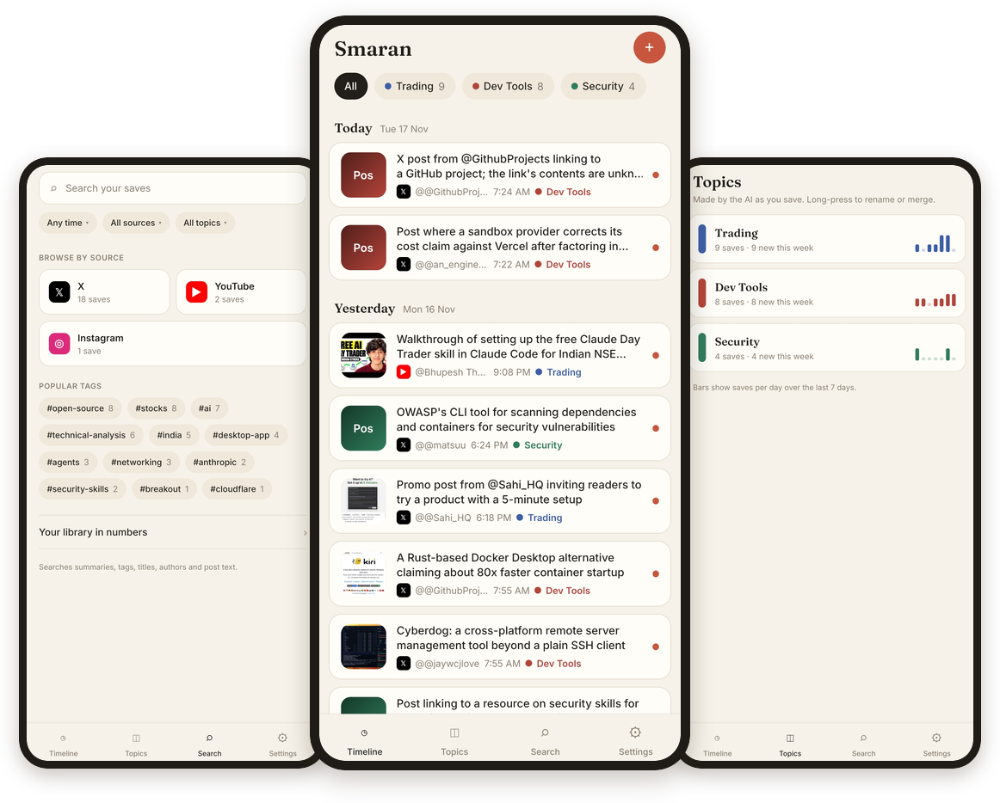
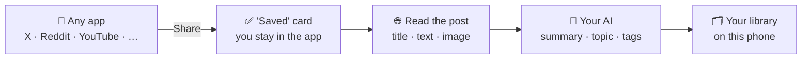
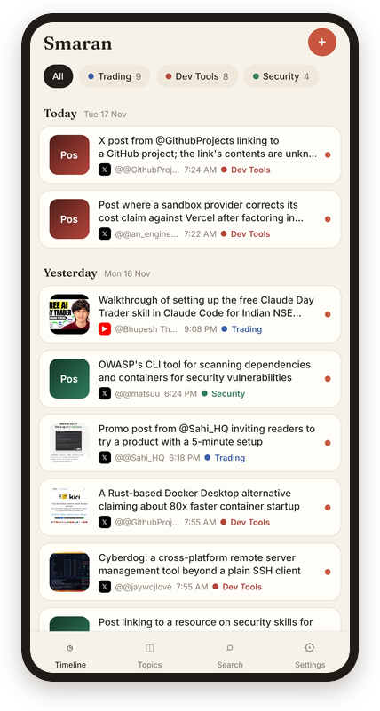
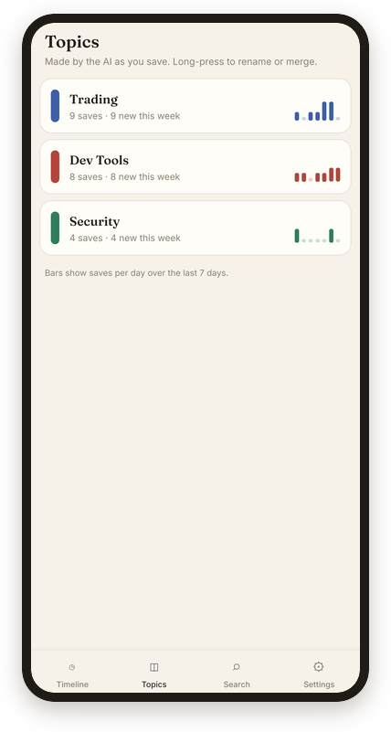
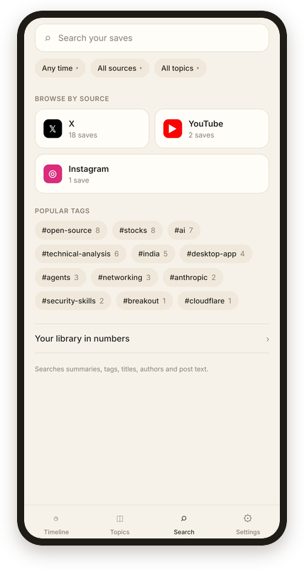
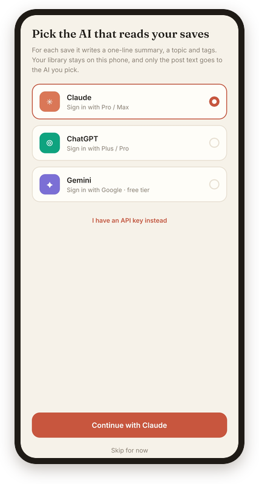
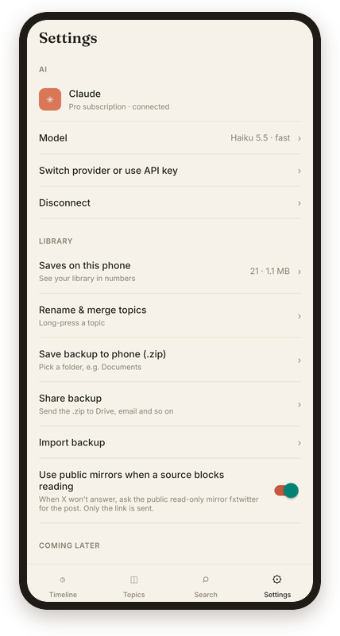

<div align="center">


# Smaran · स्मरण

**Share it now. Find it later.**

*Smaran (स्मरण) is Sanskrit for "remembrance".*

[](https://github.com/Ankit3794/smaran/actions/workflows/ci.yml)
[](https://github.com/Ankit3794/smaran/releases/latest)
[](LICENSE)

[](CONTRIBUTING.md)



</div>

---

You bookmark a thread on X. You save a reel on Instagram. You star a repo on GitHub. You leave a tab open "for later".
Three weeks on you remember *"that trading tool someone posted"*, and it's gone: buried in four apps, each with its
own bookmarks you never open.

**Smaran is one place for all of it.** Share anything to Smaran from any app's share menu. A small card says
*Saved*, and you stay right where you were. In the background, the AI **you** choose reads the post and files it
for you: a one-line summary, a topic and a few tags. Later you can find it by day, by topic, or by any word you
remember.

- 🔒 **No account and no server.** Your library is a SQLite database on your phone, and it never leaves.
- 🤖 **Bring your own AI.** Claude, ChatGPT or Gemini: sign in with your subscription or paste an API key.
- 📴 **Nothing gets lost.** Offline, or the AI is out of quota? Saves wait in a queue and finish on their own.
- 🧾 **Readable code.** Every file starts with a comment saying what it's for, and there's a
  [guided tour](docs/ARCHITECTURE.md) of the codebase for people new to app development.

## How it works



1. **Share.** Tap *Share → Smaran* in any app. A card pops up over that app, so you don't leave it. You can add a
   note while you're there.
2. **Smaran reads it.** It fetches the post's title, author, text and preview image straight from the site.
3. **Your AI files it.** It writes a one-line summary, picks a topic (or makes one) and adds tags.
4. **Find it again** on the Timeline (grouped by day), under a topic, or by searching for any word you remember.

## A look inside

<table>
  <tr>
    <td align="center" width="33%"><br /><b>Timeline</b><br /><sub>Saves grouped by day, with topic chips to filter</sub></td>
    <td align="center" width="33%"><br /><b>Topics</b><br /><sub>Made by the AI as you save, with a 7-day activity bar</sub></td>
    <td align="center" width="33%"><br /><b>Search</b><br /><sub>Full-text search, browse by source, popular tags</sub></td>
  </tr>
  <tr>
    <td align="center"><br /><b>Pick your AI</b><br /><sub>Claude, ChatGPT or Gemini, or an API key</sub></td>
    <td align="center"><br /><b>Settings</b><br /><sub>Model choice, backups, privacy switches</sub></td>
    <td valign="middle">

**Also in the box**

- Matched words highlighted in search results
- Rename and merge topics (long-press)
- Long-press a save to delete it, with **Undo**
- *Your library in numbers*: an insights screen
- Backup and restore as a plain `.zip`
- A स्म → *Smaran* launch animation

</td>
  </tr>
</table>

## Works with

| Source | What Smaran reads |
| --- | --- |
| **X / Twitter** | Post text, author, images. Falls back to the public `fxtwitter` mirror when X blocks reading (you can turn this off) |
| **Reddit** | Post title, text, subreddit, author |
| **Instagram** | Reels and posts, by caption |
| **Threads** | Post text, including `threads.com/share/…` links |
| **YouTube** | Video title, channel, description, thumbnail |
| **LinkedIn** | Public posts, articles and job pages: text and author |
| **GitHub** | Repository description and README |
| **Hacker News** | The story, plus the article it links to, so the summary is about the real thing |
| **Any web page** | Title, description, main text, preview image |
| **Plain text** | Shared text is saved as a note |

Missing a site you use? [Request it](https://github.com/Ankit3794/smaran/issues/new?template=new_source.yml), or
add it yourself: an extractor is one small file plus a test ([how to](CONTRIBUTING.md#add-a-new-source)).

## Install

1. Download `smaran-vX.Y.Z.apk` from the **[latest release](https://github.com/Ankit3794/smaran/releases/latest)**.
2. Open it on your phone. Android will ask you to allow installs from your browser or file manager the first time.
3. Open Smaran, pick your AI, and share something to it.

Updates install over the old version and keep your library. Each release lists the APK's SHA-256 checksum, so you
can check that the file wasn't changed.

> Smaran is Android-only for now. The app is written in React Native, so an iOS version is possible, but nobody has
> built or tested it yet. [Help welcome!](CONTRIBUTING.md)

## What leaves your phone

| What | Where it goes | Why |
| --- | --- | --- |
| The link you shared | The site itself (x.com, reddit.com, github.com, instagram.com, …) | To read the title, text and preview image |
| The link, for X posts only | `api.fxtwitter.com`, a public read-only mirror, when X won't answer directly | X blocks most direct reads. You can turn mirrors off in **Settings → Use public mirrors** |
| The post's text (title, author, text, caption, your note) | The AI provider you connected (Anthropic, OpenAI or Google) | To write the summary, topic and tags |
| Sign-in tokens or API keys | Only to that same provider | Stored in Android's encrypted storage (`expo-secure-store`). Never logged, never in backups |

**Nothing else is collected.** There are no analytics or crash reporters, and Smaran has no server. A backup
(**Settings → Save backup to phone** or **Share backup**) is a `.zip` that goes wherever you choose. It never
contains credentials.

## Subscription sign-in: read this first

**Signing in with a Claude, ChatGPT or Gemini subscription reuses the public OAuth clients of the official
Claude Code, Codex CLI and Gemini CLI tools.** Several open-source coding tools work this way, but:

- it **may violate those providers' terms of service**,
- the provider can block it at any time, and the sign-in then **stops working without warning**, and
- your account is the one at risk.

If you use it, you do so at your own risk. **API keys are the supported path.** Choose *I have an API key instead*
on the Connect screen. The provider bills a key per use, and summarising a save on the default fast models costs a
fraction of a cent.

## Build from source

You need Linux, macOS or Windows with:

- **Node.js 20+** and npm
- **JDK 17.** The Android Gradle plugin used here doesn't support newer JDKs. This repo's `mise.toml` pins one if
  you use [mise](https://mise.jdx.dev).
- **The Android SDK**, with platform tools, a recent platform, build tools, NDK 27.1 and CMake. Android Studio's SDK
  Manager installs these. Set `ANDROID_HOME` to the SDK folder.
- An Android phone with USB debugging on, or an emulator.

```bash
git clone https://github.com/Ankit3794/smaran.git && cd smaran
npm install
npx expo run:android          # generates android/, builds a debug APK, installs it and starts Metro
```

The first build takes a while. Later builds are incremental. To build faster for one phone, add
`-- -PreactNativeArchitectures=arm64-v8a` (most phones from 2017 on are arm64).

**Metro** is the JavaScript dev server. A debug build loads the app's JavaScript from it, so keep it running while
you develop. If the phone is on USB, run `adb reverse tcp:8081 tcp:8081`. A release build bundles the JavaScript
inside the APK and doesn't need Metro.

### A release APK in one command

```bash
npm run apk                   # clean build: regenerates android/, builds the release APK, copies it to dist/smaran.apk
```

Install it with `adb install -r dist/smaran.apk`, or copy the file to the phone and open it. Without your own upload
key it is signed with Expo's debug key, which is fine for your own phone but must not be published. Releases are
built and signed by GitHub Actions; see [docs/release.md](docs/release.md).

### Tests and type checks

```bash
npx jest              # core logic (Node) and screens (React Native test renderer), on a real SQLite
npm run typecheck     # the app, the tests and the scripts, each with its own tsconfig
```

## How it's built

<table>
  <tr>
    <td><b>App</b></td><td>React Native + <a href="https://expo.dev">Expo</a>, TypeScript, Expo Router</td>
  </tr>
  <tr>
    <td><b>Storage</b></td><td>SQLite (<code>expo-sqlite</code>) with FTS5 full-text search</td>
  </tr>
  <tr>
    <td><b>Share card</b></td><td>A small Kotlin module (<code>modules/share-receiver</code>) that shows the <i>Saved</i> card over other apps</td>
  </tr>
  <tr>
    <td><b>Background work</b></td><td><code>expo-background-task</code> and a retry queue, so saves finish even after you close the app</td>
  </tr>
  <tr>
    <td><b>AI</b></td><td>Anthropic, OpenAI and Google APIs, called straight from the phone</td>
  </tr>
</table>

The code is written to be read. If you're new to app development, start with
[docs/ARCHITECTURE.md](docs/ARCHITECTURE.md). It walks through every folder and follows one share from the share
menu to the screen.

## Roadmap

- [x] Share from any app, with background AI summaries, topics and tags
- [x] Timeline, topics, full-text search, insights
- [x] Backup and restore
- [ ] Reminders for saves you never opened
- [ ] On-device AI, so summaries work with no internet and no provider
- [ ] Video understanding (what a reel or video *says*, not just its caption)
- [ ] iOS

Ideas and votes go in [Discussions](https://github.com/Ankit3794/smaran/discussions) or
[Issues](https://github.com/Ankit3794/smaran/issues).

## Contributing

Contributions are very welcome, from typo fixes to new sources. Read [CONTRIBUTING.md](CONTRIBUTING.md) to get
set up, and please follow the [Code of Conduct](CODE_OF_CONDUCT.md). To report a security problem, see
[SECURITY.md](SECURITY.md). Please don't open a public issue for those.

## License

[MIT](LICENSE). Use it, fork it, learn from it.

<div align="center">
<sub>Made for everyone who has ever thought <i>"I saved that somewhere…"</i></sub>
</div>
